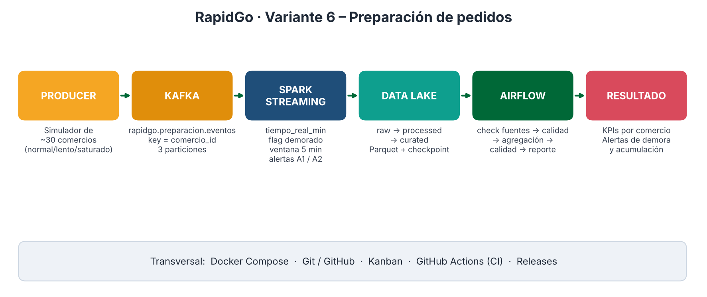

# RapidGo · Variante 6 – Preparación de pedidos

Pipeline Big Data end-to-end para detectar **demoras y acumulación de pedidos en comercios** (restaurantes, panaderías, farmacias, supermercados) antes de que el pedido llegue al repartidor.

**Curso:** Línea de Profundización I – Big Data · Ingeniería de Sistemas y Computación – Facatativá
**Equipo 3**

| Integrante | GitHub | Rol principal |
|---|---|---|
| Juan Quiroga | [@JuanD1P](https://github.com/JuanD1P) | Kafka, producer, DAG de Airflow e integración |
| Laura Posada | [@LauraJPs](https://github.com/LauraJPs) | Spark Structured Streaming, Data Lake y quality gate |
| Daniel Solano | [@DanielSolano7](https://github.com/DanielSolano7) | Pruebas, CI, ADRs, fallo controlado y documentación |

**Estado actual:** `v1.0.0` – pipeline completo Kafka → Spark → Data Lake → Airflow, con quality gate en GitHub Actions.

🎬 **Video final (≤ 10 min):** [Ver en YouTube](https://youtu.be/tzMMP3NlS70)

## Problema y valor
Cuando un comercio se demora preparando o acumula pedidos, el repartidor espera, la comida se enfría y el cliente recibe tarde. RapidGo necesita indicadores y alertas casi en tiempo real por comercio para actuar a tiempo.

**Valor de la solución:** en segundos se sabe qué comercio está preparando lento (alerta A1) o acumulando pedidos (alerta A2), y cada ejecución del DAG entrega un reporte diario con los comercios críticos, la calidad de los datos y alertas consolidadas sin repeticiones, para pausar comercios, reasignar repartidores o ajustar el tiempo prometido al cliente.

## Arquitectura



```
Producer (simulador de comercios)
   │  key = comercio_id
   ▼
Kafka  topic: rapidgo.preparacion.eventos (3 particiones)
   ▼
Spark Structured Streaming  → parseo, tiempo_real_min, flag demora, ventanas 5 min, alertas
   ▼
Data Lake  raw → processed → curated (Parquet + checkpoint)
   ▼
Airflow  validar fuentes → calidad raw → agregación → calidad curated → reporte
   ▼
KPIs y alertas por comercio
```

## Tecnologías y rol de cada una
| Tecnología | Versión | Rol en el pipeline |
|---|---|---|
| Python | 3.13 | Producer (simulador de 30 comercios), pruebas y lógica del DAG |
| Apache Kafka (KRaft) | 3.9.1 | Bus de eventos: topic `rapidgo.preparacion.eventos` (3 particiones) y `rapidgo.preparacion.alertas` |
| Apache Spark Structured Streaming | 4.2.0 | Limpieza, deduplicación, tiempo de preparación, ventanas de 5 min con watermark, KPIs y alertas |
| Parquet (Data Lake local) | — | Capas `raw → processed → curated` con checkpoints |
| Apache Airflow | 3.1.8 | DAG de calidad, KPIs diarios, consolidación de alertas y reporte |
| Docker Compose | v2 | Levanta todo el pipeline con un solo comando |
| GitHub Actions | — | CI (`validar`, `validar-dag`, `pipeline-e2e`) y quality gate del release (`release.yml`) |
| pytest | 8.4 | Pruebas de contrato, reglas A1/A2, simulador, lógica del DAG y estructura del DAG |

## Eventos, KPIs y alertas
- **Topic:** `rapidgo.preparacion.eventos` · **Key:** `comercio_id` · **Particiones:** 3 → [ADR-001](docs/decisions/ADR-001-key-y-particiones-kafka.md)
- **Contrato:** [`samples/schema_evento_preparacion.json`](samples/schema_evento_preparacion.json)
- **KPIs:** tiempo promedio de preparación, backlog por comercio, % pedidos demorados, comercios críticos.
- **Alertas:** `A1_PREPARACION_EXCEDIDA` (real > 1.5× estimado o > 30 min) y `A2_ACUMULACION_PEDIDOS` (cola promedio ≥ 8 en 5 min).

Detalle: [docs/diseno_variante6.md](docs/diseno_variante6.md)

## Ejecución local
**Prerequisitos:** Docker Desktop (o Docker Engine + Compose v2), Git y ~6 GB de RAM libres para Docker
(cerrar otros programas en portátiles de 8–16 GB). En Windows usar Git Bash.

**Pasos:**
1. Clonar y levantar todo (la primera vez descarga imágenes y el conector de Kafka, 3–5 min).
2. Esperar ~3 min a que Spark escriba datos.
3. Ejecutar `bash scripts/verificar_pipeline.sh` (revisa contenedores, Data Lake, dispara el DAG y muestra el reporte).

```bash
git clone https://github.com/LauraJPs/rapidgo-v6-preparacion.git
cd rapidgo-v6-preparacion
docker compose up -d --build
docker compose logs kafka-init          # topic con PartitionCount: 3
docker compose logs -f producer         # eventos enviados por partición
docker compose logs -f spark            # lotes, KPIs y alertas
```

| Servicio | URL |
|---|---|
| Kafka UI | http://localhost:8085 |
| Spark UI | http://localhost:4040 |
| Airflow UI | http://localhost:8080 (sin login en local) |

La primera vez Spark descarga el conector de Kafka (1–3 min). El simulador usa un reloj acelerado: `VELOCIDAD=2` → 1 segundo real = 2 minutos simulados, así las ventanas de 5 min se cierran en segundos.

Consultar los resultados del Data Lake:
```bash
docker compose exec spark /opt/spark/bin/spark-submit /opt/app/consultar_lake.py
```

Verificar todo de punta a punta (contenedores → Data Lake → DAG → reporte):
```bash
bash scripts/verificar_pipeline.sh
```

Detener todo: `docker compose down`. Al volver a levantar, Kafka arranca vacío y `kafka-init` limpia
el Data Lake automáticamente (los offsets y checkpoints viejos ya no sirven). Para pausar sin perder
datos: `docker compose stop` / `docker compose start`; el producer continúa su reloj simulado desde
el último evento del topic.

### Orquestación con Airflow
El DAG `rapidgo_v6_preparacion` (`airflow/dags/dag_preparacion.py`) corre sobre el Data Lake que escribe Spark:

```
verificar_fuentes → validar_calidad_processed → ┬→ agregar_kpis_diarios ─┬→ validar_calidad_curated → generar_reporte
                                                └→ consolidar_alertas  ──┘
```

| Tarea | Qué hace | Salida / XCom |
|---|---|---|
| `verificar_fuentes` | Exige archivos Parquet en raw y processed (cuenta también curated) y mide la frescura. Reintenta con espera exponencial (ADR-003) | conteo por fuente + minutos desde la última escritura |
| `validar_calidad_processed` | Nulos, tipos de evento, equipo, cola ≥ 0, duplicados ≤ 1 % | métricas |
| `agregar_kpis_diarios` | K1, K2, K3 por día y comercio + comercio crítico | `curated/kpis_diarios/` |
| `consolidar_alertas` | No repite la misma alerta del mismo comercio en 60 min (pendiente del ADR-002) | `curated/alertas_consolidadas/` |
| `validar_calidad_curated` | Rangos y unicidad de la salida | errores |
| `generar_reporte` | Reporte Markdown con resumen y comercios críticos | `curated/reportes/reporte_*.md` |

Ejecutarlo:
1. Con el pipeline corriendo (`docker compose up -d --build`), esperar ~3 min a que Spark escriba datos.
2. Abrir http://localhost:8080 → **Dags** → `rapidgo_v6_preparacion` → **Trigger**.
3. Ver el grafo en la pestaña **Graph** y los logs de cada tarea.

Antes de Airflow arranca `datalake-init`, que deja `curated/kpis_diarios`, `curated/alertas_consolidadas` y `curated/reportes` con permiso de escritura.

Fallo controlado y recuperación: ver [ADR-003](docs/decisions/ADR-003-reintentos-verificar-fuentes.md) y [checkpoint semana 3](docs/checkpoints/semana3.md).

### Data Lake generado
| Ruta | Contenido |
|---|---|
| `datalake/raw/eventos` | Mensajes de Kafka con partición y offset |
| `datalake/processed/eventos` | Eventos limpios + `tiempo_real_min`, `demorado`, `alerta_a1` (por `fecha`, `zona`) |
| `datalake/curated/kpis_comercio_5min` | K1, K2, K3 y alerta A2 por comercio y ventana de 5 min |
| `datalake/curated/alertas/` | Alertas A1 y A2 (también publicadas en `rapidgo.preparacion.alertas`) |
| `datalake/curated/kpis_diarios/` · `alertas_consolidadas/` · `reportes/` | Salidas del DAG de Airflow |


### Problemas conocidos (Windows / Git Bash)
- `docker run ... /opt/spark/bin/spark-submit` falla con `/opt/spark/work-dir/C:/Program Files/Git/opt/...: No such file or directory`: Git Bash convierte las rutas que empiezan por `/`. Solución: `echo 'export MSYS_NO_PATHCONV=1' >> ~/.bashrc && source ~/.bashrc`.
- `Conflict. The container name "/rapidgo-kafka" is already in use`: hay un contenedor viejo con ese nombre. Solución: `docker rename rapidgo-kafka rapidgo-kafka-viejo`.
- Al pegar comandos con Ctrl+V en Git Bash aparece `^[[200~`: escribir los comandos o pegarlos con clic derecho → Paste, una línea a la vez.
- Tareas del DAG fallan con `PermissionError: [Errno 13] Permission denied: '/opt/datalake/curated/...'`: Spark (root) creó `curated/` y Airflow (uid 50000) no puede escribir. Lo evita el servicio `datalake-init` del compose; arreglo manual: `MSYS_NO_PATHCONV=1 docker exec -u root rapidgo-v6-airflow chmod -R a+rwX /opt/datalake/curated` y *Clear* de las tareas.
- Spark no escribe después de `docker compose down` (offsets viejos en el checkpoint): desde la Semana 4 `kafka-init` limpia el Data Lake cuando el topic es nuevo; si se borró solo Kafka, ejecutar `docker compose down` y volver a levantar.

## Pruebas y CI
```bash
pip install -r requirements.txt
pytest -v
```
El workflow `.github/workflows/ci.yml` corre en cada push, Pull Request y manualmente (`workflow_dispatch`):

| Job | Qué valida |
|---|---|
| `validar` | Sintaxis Python, pruebas (contrato, reglas A1/A2, simulador, lógica del DAG) y `docker compose config` |
| `validar-dag` | Instala Airflow 3.1.8 e importa el DAG con `DagBag` (≥5 tareas, dependencias, retries) |
| `pipeline-e2e` | Levanta todo con `docker compose up -d --build` y ejecuta `scripts/verificar_pipeline.sh` (Kafka → Spark → Data Lake → DAG → reporte) |

**Ejecutarlo a mano:** pestaña **Actions** → **CI RapidGo** → **Run workflow** → rama `main` → **Run workflow**.

**Quality gate del release:** `.github/workflows/release.yml` se activa al subir un tag `v*`, vuelve a correr
todo el CI y solo si queda en verde publica el GitHub Release con las notas de `docs/releases/<tag>.md`.
Si el CI falla, no se libera.

## Resultados y evidencias
| Evidencia | Valor real | Fuente |
|---|---|---|
| Distribución por partición (key `comercio_id`) | 16.673 / 16.366 / 10.372 mensajes (10 / 13 / 7 comercios) | [checkpoint semana 2](docs/checkpoints/semana2.md) |
| K1 tiempo promedio de preparación | 21,3 min (mediana 19,9 · máx. 59,1) | [checkpoint semana 2](docs/checkpoints/semana2.md) |
| K3 % pedidos demorados | 56,7 % | [checkpoint semana 2](docs/checkpoints/semana2.md) |
| A2 confirmada en 2 ventanas seguidas | 44,2 → 35,1 alertas A2 por cada 1.000 mensajes | [ADR-002](docs/decisions/ADR-002-a2-ventanas-consecutivas.md) |
| Reporte del DAG (ejecución local) | 16.953 eventos · 10 comercios críticos de 30 · 3.265 → 435 alertas consolidadas | [checkpoint semana 3](docs/checkpoints/semana3.md) |
| Fallo controlado y recuperación | Falla en 38 s con el lake vacío; con ADR-003 se recupera solo en el intento 3 (1 min 09 s) | [ADR-003](docs/decisions/ADR-003-reintentos-verificar-fuentes.md) · [capturas](docs/evidencias/Semana3/) |
| Pipeline de punta a punta en GitHub Actions | 577 eventos · 7 comercios críticos · validación OK · frescura 0,2 min | [checkpoint semana 4](docs/checkpoints/semana4.md) |

Comercios saturados (COM-027..030) aparecen como críticos en todas las ejecuciones: cola promedio de 9 a 18 pedidos y hasta 75 % de pedidos demorados, que es justo el comportamiento que el sistema debe detectar.

## Limitaciones conocidas y trabajo futuro
- **Datos simulados:** el producer genera 30 comercios con reloj acelerado (1 s real = 2 min simulados); no hay conexión a datos reales de RapidGo.
- **Un solo broker Kafka** sin replicación (factor 1): suficiente para el entorno local, no para producción.
- **Spark en modo local** y muchos Parquet pequeños: tras ~1 h aparece *falling behind* en portátiles con Windows. Trabajo futuro: compactar archivos y usar almacenamiento de objetos (S3/MinIO).
- **Airflow standalone** con SQLite y DAG manual (`schedule=None`): en producción usaría PostgreSQL, un executor distribuido y un horario.
- La **frescura** del Data Lake solo genera un aviso en el reporte; en el futuro podría fallar el DAG o notificar por correo o Slack.
- `docker compose down` borra el estado de Kafka; por diseño, `kafka-init` limpia el Data Lake al arrancar de nuevo.

## Tabla de contribuciones
| Integrante | Responsabilidades | Issues | PR principales |
|---|---|---|---|
| **Juan Quiroga** (@JuanD1P) | Contrato JSON del evento, key y particiones de Kafka (ADR-001), producer con comercios normales, lentos y saturados, DAG de Airflow (6 tareas, retries, XCom), integración final (limpieza automática del Data Lake, reloj del producer, frescura, `verificar_pipeline.sh`) | #2, #4, #6, #11, #14 | #18, #22, #27, #30 |
| **Laura Posada** (@LauraJPs) | KPIs y reglas de alerta, README inicial y arquitectura, Spark Structured Streaming y Data Lake Parquet, CI con validación del DAG y confirmación de A2 con estado, quality gate final (`pipeline-e2e`, `release.yml`) y releases | #3, #5, #7, #8, #12, #15 | #19, #20, #23, #28, #31 |
| **Daniel Solano** (@DanielSolano7) | Estructura base y `docker-compose`, CI con GitHub Actions y pruebas, ADR-002, fallo controlado y recuperación (ADR-003, `datalake-init`), README final, checkpoint de la semana 4 y guion del video | #1, #9, #10, #13, #16 | #17, #21, #24, #29, #32 |

Cada PR tuvo revisión de otro integrante y CI en verde antes del merge (ruleset `proteger-main`).
Kanban: [RapidGo V6 – Kanban Preparación de pedidos](https://github.com/users/LauraJPs/projects/1).

## Flujo de trabajo
`Issue → Branch → PR → GitHub Actions → Review → Merge → Release`. No se hacen cambios funcionales directamente sobre `main`.

## Releases
| Versión | Contenido |
|---|---|
| v0.1.0-foundation | Arquitectura, contrato, KPIs, alertas, Kanban, ADR-001 |
| v0.2.0-streaming | Producer, Spark Structured Streaming, Data Lake Parquet, alertas A1/A2 (A2 con 2 ventanas seguidas, ADR-002), CI |
| v0.3.0-orchestration | DAG de Airflow (6 tareas, retries, XCom), CI con validación del DAG, fallo controlado (ADR-003) |
| v1.0.0 | Integración final (arranque con un solo comando), quality gate de punta a punta en CI, `release.yml`, README final y video |

## Documentación
- Diseño de la variante: [docs/diseno_variante6.md](docs/diseno_variante6.md)
- Decisiones: [ADR-001](docs/decisions/ADR-001-key-y-particiones-kafka.md) · [ADR-002](docs/decisions/ADR-002-a2-ventanas-consecutivas.md) · [ADR-003](docs/decisions/ADR-003-reintentos-verificar-fuentes.md)
- Checkpoints: [semana 1](docs/checkpoints/semana1.md) · [semana 2](docs/checkpoints/semana2.md) · [semana 3](docs/checkpoints/semana3.md) · [semana 4](docs/checkpoints/semana4.md)
- Guion del video: [docs/video/guion.md](docs/video/guion.md)
