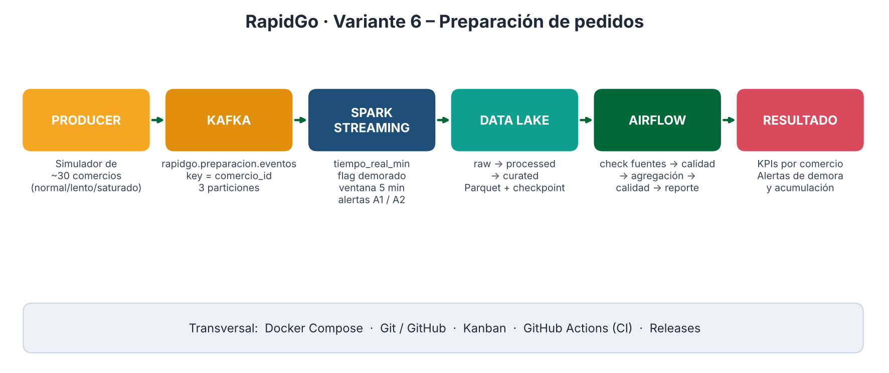

# RapidGo · Variante 6 – Preparación de pedidos

Pipeline Big Data end-to-end para detectar **demoras y acumulación de pedidos en comercios** (restaurantes, panaderías, farmacias, supermercados) antes de que el pedido llegue al repartidor.

**Curso:** Línea de Profundización I – Big Data · Ingeniería de Sistemas y Computación – Facatativá
**Equipo 3**

| Integrante | GitHub | Rol Semana 2 |
|---|---|---|
| Juan Quiroga | @JuanD1P | Kafka / Producer |
| Laura Posada | @LauraJPs | Spark / Data Lake |
| Daniel Solano | @DanielSolano7 | Tests / CI |

**Estado actual:** `v0.2.0-streaming` – pipeline Kafka → Spark → Data Lake funcionando y CI activo.

## Problema
Cuando un comercio se demora preparando o acumula pedidos, el repartidor espera, la comida se enfría y el cliente recibe tarde. RapidGo necesita indicadores y alertas casi en tiempo real por comercio para actuar a tiempo.

## Arquitectura



```
Producer (simulador de comercios)
   │  key = comercio_id
   ▼
Kafka  topic: rapidgo.preparacion.eventos (3 particiones)
   ▼
Spark Structured Streaming  → parseo, tiempo_real_min, flag demora, ventanas 5 min, alertas
   ▼
Data Lake  raw → processed → curated (Parquet + checkpoint)
   ▼
Airflow  validar fuentes → calidad raw → agregación → calidad curated → reporte
   ▼
KPIs y alertas por comercio
```

## Eventos, KPIs y alertas
- **Topic:** `rapidgo.preparacion.eventos` · **Key:** `comercio_id` · **Particiones:** 3 → [ADR-001](docs/decisions/ADR-001-key-y-particiones-kafka.md)
- **Contrato:** [`samples/schema_evento_preparacion.json`](samples/schema_evento_preparacion.json)
- **KPIs:** tiempo promedio de preparación, backlog por comercio, % pedidos demorados, comercios críticos.
- **Alertas:** `A1_PREPARACION_EXCEDIDA` (real > 1.5× estimado o > 30 min) y `A2_ACUMULACION_PEDIDOS` (cola promedio ≥ 8 en 5 min).

Detalle: [docs/diseno_variante6.md](docs/diseno_variante6.md)

## Ejecución local
Requisitos: Docker Desktop (o Docker Engine + Compose v2) y Git. Se recomiendan 6 GB de RAM libres para Docker.

```bash
git clone https://github.com/LauraJPs/rapidgo-v6-preparacion.git
cd rapidgo-v6-preparacion
docker compose up -d --build
docker compose logs kafka-init          # topic con PartitionCount: 3
docker compose logs -f producer         # eventos enviados por partición
docker compose logs -f spark            # lotes, KPIs y alertas
```

| Servicio | URL |
|---|---|
| Kafka UI | http://localhost:8085 |
| Spark UI | http://localhost:4040 |

La primera vez Spark descarga el conector de Kafka (1–3 min). El simulador usa un reloj acelerado: `VELOCIDAD=2` → 1 segundo real = 2 minutos simulados, así las ventanas de 5 min se cierran en segundos.

Consultar los resultados del Data Lake:
```bash
docker compose exec spark /opt/spark/bin/spark-submit /opt/app/consultar_lake.py
```

Detener todo: `docker compose down` (los datos quedan en `datalake/`).

### Data Lake generado
| Ruta | Contenido |
|---|---|
| `datalake/raw/eventos` | Mensajes de Kafka con partición y offset |
| `datalake/processed/eventos` | Eventos limpios + `tiempo_real_min`, `demorado`, `alerta_a1` (por `fecha`, `zona`) |
| `datalake/curated/kpis_comercio_5min` | K1, K2, K3 y alerta A2 por comercio y ventana de 5 min |
| `datalake/curated/alertas/` | Alertas A1 y A2 (también publicadas en `rapidgo.preparacion.alertas`) |

## Pruebas y CI
```bash
pip install -r requirements.txt
pytest -v
```
El workflow `.github/workflows/ci.yml` corre en cada push, Pull Request y manualmente (`workflow_dispatch`): sintaxis Python, pruebas del contrato, reglas A1/A2 y simulador, y `docker compose config`.

## Flujo de trabajo
`Issue → Branch → PR → GitHub Actions → Review → Merge → Release`. No se hacen cambios funcionales directamente sobre `main`.

## Releases
| Versión | Contenido |
|---|---|
| v0.1.0-foundation | Arquitectura, contrato, KPIs, alertas, Kanban, ADR-001 |
| v0.2.0-streaming | Producer, Spark Structured Streaming, Data Lake Parquet, alertas A1/A2, CI |
| v0.3.0-orchestration | _pendiente_ |
| v1.0.0 | _pendiente_ |
