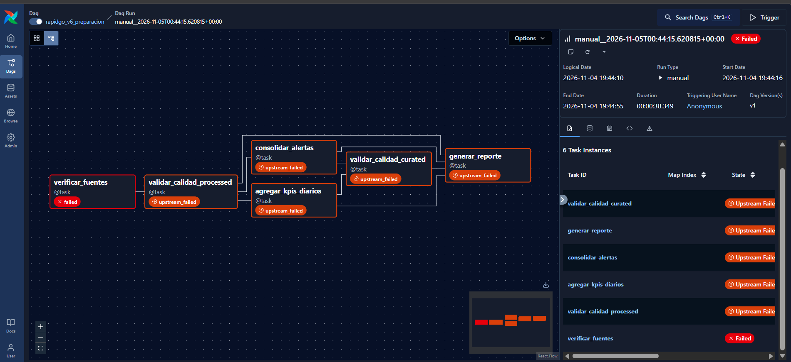

# Checkpoint Semana 3 – v0.3.0-orchestration

**Equipo 3 · Variante 6 – Preparación de pedidos**
Juan Quiroga · Laura Posada · Daniel Solano

## 1. Qué quedó funcionando
- **DAG de Airflow** `rapidgo_v6_preparacion` con 6 tareas, dependencias, retries y XCom: verificar fuentes → validar calidad de processed → KPIs diarios + consolidación de alertas → validar calidad de curated → reporte (PR #27).
- **Consolidación de alertas** (pendiente del ADR-002): la misma alerta del mismo comercio no se repite en 60 min. En la ejecución real: **3265 alertas → 435 consolidadas** (A1: 260 · A2: 175).
- **CI ampliado**: el job `validar-dag` instala Airflow 3.1.8 y valida el DAG con `DagBag`; el job `validar` corre las pruebas de contrato, reglas, simulador y lógica del DAG (PR #28).
- **Rendimiento de Spark** (pendiente del ADR-002): la confirmación de A2 usa un estado pequeño en lugar de releer todo el histórico (0,27–1,07 s por lote) y el trigger pasó a 30 s (PR #28).
- **Fallo controlado + ADR-003**: reintentos con espera exponencial en `verificar_fuentes` y servicio `datalake-init` para los permisos del Data Lake (PR #29).

Reporte real generado por el DAG (`curated/reportes/reporte_20261105_011039.md`): 16.953 eventos, 30 comercios, 4459 pedidos, 0,0 % duplicados, 60 filas de KPIs diarios y **10 comercios críticos de 30** (COM-021 y COM-027..030 encabezan, con 74–100 % de pedidos demorados).

## 2. Tarea que falló y mensaje real del log
- **Escenario:** Data Lake vacío y Kafka/producer/Spark detenidos; DAG disparado manualmente (run `manual__2026-11-05T00:44:15`).
- **Tarea que falló:** `verificar_fuentes`, tras **3 intentos (38,3 s)**.
- **Mensaje real:**
  ```
  [2026-11-04 19:44:51] ERROR - Task failed with exception
  RuntimeError: Fuentes sin archivos Parquet: ['raw', 'processed'] · conteo={'raw': 0, 'processed': 0, 'kpis_5min': 0, 'alertas': 0}. ¿Están corriendo el producer y Spark?
  ```

## 3. Tareas afectadas
`validar_calidad_processed`, `agregar_kpis_diarios`, `consolidar_alertas`, `validar_calidad_curated` y `generar_reporte` quedaron en **upstream_failed** (no se ejecutaron).



## 4. Cambio que resolvió el problema
1. **Recuperación manual:** levantar `kafka`, `producer` y `spark`, esperar ≈ 6 min (primera vez, con descarga de imágenes) y hacer *Clear* de `verificar_fuentes` con *Downstream*. `verificar_fuentes` pasó en el intento 4 con `{'raw': 36, 'processed': 192, 'kpis_5min': 40, 'alertas': 87}`.
2. **Segundo fallo real durante la recuperación:** `agregar_kpis_diarios` y `consolidar_alertas` fallaron con
   ```
   PermissionError: [Errno 13] Permission denied: '/opt/datalake/curated/alertas_consolidadas'
   ```
   Spark (root) había recreado `curated/` con `drwxr-xr-x root root` y Airflow corre como `uid=50000`. Se corrigió con `chmod` y *Clear* de las tareas fallidas → **6 tareas en `success`** (12 s) y reporte generado.
3. **Cambios permanentes (ADR-003, PR #29):**
   - `verificar_fuentes` reintenta 4 veces con espera exponencial (20 s → 2 min). Con el DAG disparado al arrancar el pipeline, se recuperó solo en el **intento 3** y el run terminó en `success` en **1 min 09 s** sin intervención manual. Con el pipeline realmente caído, el run falla en el intento 5 a los **5 min 51 s**.
   - Servicio `datalake-init` en `docker-compose.yml` que crea las carpetas de salida de Airflow con permiso de escritura; con él ambas tareas pasaron al primer intento.

Detalle y alternativas: [ADR-003](../decisions/ADR-003-reintentos-verificar-fuentes.md). Capturas: [`docs/evidencias/Semana3/`](../evidencias/Semana3/).

## 5. Pendientes para la Semana 4
- Spark sigue mostrando *falling behind* tras ~1 h con trigger de 30 s (muchos Parquet pequeños sobre el bind mount de Windows).
- Revisar la antigüedad del último archivo para distinguir "sin datos todavía" de "pipeline caído".

## 6. Enlaces
- PR DAG + Airflow (Juan): #27
- PR CI ampliado + rendimiento Spark (Laura): #28
- PR fallo controlado + ADR-003 (Daniel): #29
- Action con `validar-dag`: https://github.com/LauraJPs/rapidgo-v6-preparacion/pull/29/checks
- Release: v0.3.0-orchestration
